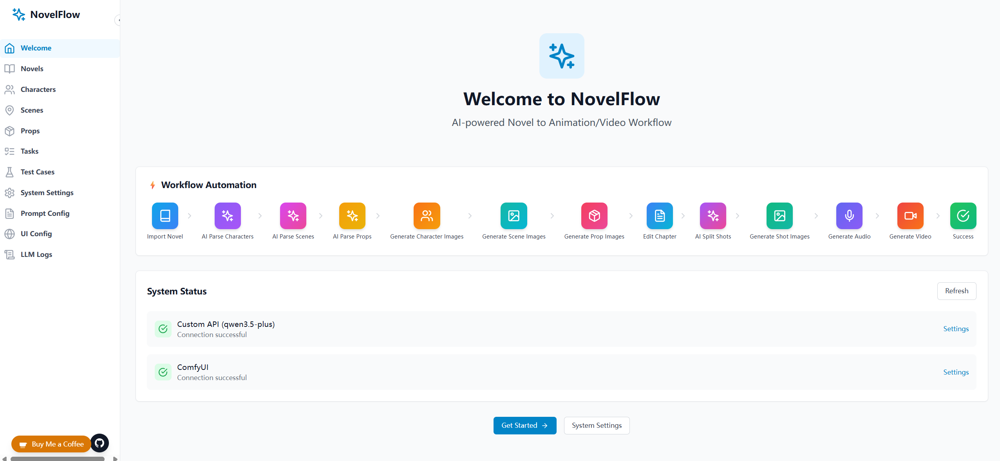

# AI-NovelFlow

**[简体中文](README.md) | [繁體中文](README_TW.md) | [English](README_EN.md) | [日本語](README_JA.md) | [한국어](README_KO.md)**

AI-Powered Novel to Video Platform

## Project Overview

NovelFlow turns novel text, character and scene references, shot images, audio, and video tasks into an editable production workflow. You can review each stage or process chapters and shots in batches.

**Production flow:** Import TXT/EPUB or an example novel → extract characters, scenes, and props → create reference images and voices → edit chapters and split shots → generate and review shot images → plan and render clips with Video Director → merge chapter/novel videos → create a cover and optionally upload to YouTube.

Video Director supports multi-reference generation, video continuation, and timeline-anchored extension. It stores prompts, tasks, keyframes, and generated artifacts for inspection and retries.

## Interface Preview



## Video Introduction

📺 <a href="https://www.bilibili.com/video/BV1VdZbBDEXF" target="_blank">Bilibili: AI-NovelFlow Novel to Video Platform Introduction</a>

📺 <a href="https://www.youtube.com/watch?v=IlMbeDme2F8" target="_blank">YouTube: AI-NovelFlow Novel to Video Platform Introduction</a>

📺 <a href="https://www.youtube.com/watch?v=DybveicQ9eQ" target="_blank">YouTube: How to Install on Windows</a>

## Community

| Telegram Group | QQ Group |
|:---:|:---:|
| <a href="https://t.me/AI_NovelFlow" target="_blank">@AI_NovelFlow</a> | 1083469624 |
|  |  |

## Tech Stack

- **Frontend:** React, TypeScript, Tailwind CSS, Vite, Zustand
- **Backend:** FastAPI, SQLAlchemy, SQLite, background jobs and file storage
- **AI and media:** Configurable LLM providers, ComfyUI, FFmpeg; Moss Image and Qwen Image 2.1 image presets, MiniMax H3 video presets, and Qwen3-TTS audio presets
- **Interface:** Simplified/Traditional Chinese, English, Japanese, Korean, and configurable timezones

## Main Features

- **Novels and chapters:** Create, edit, delete, and import TXT/EPUB novels; parse chapters, import/split them in batches, or start from examples.
- **Asset libraries:** Extract characters, scenes, and props by novel or chapter; generate and manage reference images, character voices, and reference audio.
- **Shots and images:** AI shot splitting, manual editing, batch image generation, reference binding, keyframes, single/multi-image editing, AI image quality review, and HD repaint.
- **Video Director:** Plan shots and clips with multi-reference generation, continuation, and temporal anchors; retain prompts, LLM logs, tasks, and outputs.
- **Clip inspection:** Inspect generated frames, timelines, source evidence, and observations to investigate a clip.
- **Audio and delivery:** Optional voice design and speech generation; merge clips, chapters, and novels, preview first-appearance nameplates, create covers, and upload to YouTube.
- **Workflows and prompts:** Manage system/custom ComfyUI workflows, node mappings, workflow import/export, and prompt templates.
- **Tasks and notifications:** Background jobs, retry and recovery, business events, page sounds, and Feishu/Telegram notifications.
- **Localization:** Five interface languages and user-selected timezones.

## Project Structure

```
AI-NovelFlow/
├── backend/              # FastAPI Backend
│   ├── app/
│   │   ├── api/         # API Routes
│   │   ├── core/        # Core Configuration
│   │   ├── models/      # Database Models
│   │   ├── repositories/ # Data Repository Layer
│   │   ├── schemas/     # Pydantic Models
│   │   ├── services/    # Business Logic (LLM, ComfyUI)
│   │   └── utils/       # Utility Functions
│   ├── migrations/      # Database Migration Scripts
│   ├── prompt_templates/ # Prompt Template Files
│   ├── workflows/       # ComfyUI Workflow Configs
│   ├── user_workflows/  # User Custom Workflows
│   ├── user_story/      # Generated images/videos storage
│   └── run_server.py
├── frontend/            # React Frontend
│   └── my-app/
│       ├── src/
│       │   ├── components/  # Components
│       │   ├── i18n/        # i18n translation files
│       │   ├── pages/       # Pages
│       │   ├── stores/      # State Management
│       │   └── types/       # TypeScript Types
│       └── package.json
├── windows_gpu_monitor/ # Windows GPU Monitor Service (Optional)
│   ├── gpu_monitor.py   # GPU Monitor Service
│   ├── requirements.txt # Dependencies
│   └── start.bat        # Windows Startup Script
├── debug/workflows/     # Debug workflow samples, not loaded as system defaults
└── README.md
```

## Quick Start

### Backend Startup

```bash
cd backend
source venv/bin/activate  # Windows: venv\Scripts\activate
uvicorn app.main:app --reload --host 0.0.0.0 --port 8000
```

Backend service will run at http://localhost:8000

### Frontend Startup

```bash
cd frontend/my-app
npm install
npm run dev
```

Frontend service will run at http://localhost:5173

## API Documentation

Visit after starting backend: http://localhost:8000/docs

## Configuration

### 1. LLM API Configuration

System Settings provides presets for DeepSeek, OpenAI, Gemini, Anthropic, Azure OpenAI, Alibaba Cloud Bailian, Ollama, and custom OpenAI-compatible services. Configure the endpoint, model, and API key for your provider; local services such as Ollama can use their own settings. Proxy settings are available, and Prompt Configuration manages templates for each production stage.

### 2. ComfyUI Configuration

- Default address: `http://localhost:8188`; change it in System Settings.
- System workflow JSON files live in `backend/workflows/`, with registration and node mappings in `backend/app/constants/workflow.py`. Uploaded workflows live in `backend/user_workflows/`. The UI can import, export, and select workflows and map prompt, reference, duration, and output nodes.
- Current image presets cover Moss Image T2I character four-view, scene, and prop generation, plus Qwen Image 2.1 shots, keyframes, and single/multi-image editing. Video presets cover MiniMax H3 multi-reference generation, video continuation, temporal extension, second-pass sampling, and 3D latent upscaling. Audio workflows also include Qwen3-TTS.
- The active workflow depends on the database selection. `debug/workflows/` contains examples and is not loaded as system presets.

**Models and nodes:** [Quark download](https://pan.quark.cn/s/2a630b7755ed). Install only what your selected workflow JSON references. The 2026-10-23 inventory covers Moss Image, Qwen Image 2.1 and local Qwen PE rewrite models, plus the H3 model/VAE/LoRA/upscaler and custom node plugins. See the [ComfyUI dependency inventory](docs/COMFYUI_DEPENDENCIES.md) for exact paths, plugin repositories, and active/inactive status.

### 3. Windows GPU Monitor (Optional)

If ComfyUI runs on a remote Windows server, you can deploy the `windows_gpu_monitor` service to get real-time GPU status.

**Features**:
- Real-time monitoring of GPU usage, temperature, VRAM
- Monitor memory usage
- Display queue task count

**Deployment Steps**:

```bash
cd windows_gpu_monitor

# Install dependencies
pip install -r requirements.txt

# Start service
start.bat
```

Service runs at http://localhost:5000 by default

**Access Test**:
- Home: http://localhost:5000/
- GPU Status: http://localhost:5000/gpu-stats

### 4. Prompt Template Configuration

View system templates and create, copy, edit, export, or bind custom templates to novels in Prompt Configuration. Templates cover asset extraction, shots, video planning, image quality review, and other stages. LLM logs help trace the calls used.

### 5. Internationalization and Timezone Settings

**Language Settings**:
- Simplified Chinese (zh-CN)
- Traditional Chinese (zh-TW)
- English (en-US)
- 日本語 (ja-JP)
- 한국어 (ko-KR)

**Timezone Settings**:
- Support major global timezones
- All time displays (task list, LLM logs, etc.) converted to specified timezone
- Backend stores UTC time uniformly, frontend dynamically converts based on user settings

Configure in [System Settings] → [Language & Timezone] page.

## Implemented Capabilities

- [x] Novel/chapter management and character, scene, and prop libraries
- [x] Shot splitting, batch image generation, image review, and HD repaint
- [x] Video Director, multi-reference/continuation/temporal extension, and clip inspection
- [x] Audio generation, chapter/novel merges, nameplate previews, and covers
- [x] Workflow/prompt management, task recovery, event notifications, and YouTube upload
- [x] Five interface languages and timezone settings

## Usage Instructions

1. **Set up services:** Start the backend and frontend, configure an LLM and ComfyUI in System Settings, and install the models/nodes needed by your workflow.
2. **Import a novel:** Create a novel, import TXT/EPUB, or use an example; batch import or split chapters when needed.
3. **Build asset libraries:** Extract characters, scenes, and props, then generate reference images; optionally design voices or upload reference audio.
4. **Prepare shots:** Edit chapters, split and correct shots, generate shot images and keyframes, review image quality, and use HD repaint where needed.
5. **Render audio/video:** Generate optional audio; choose a Video Director workflow and references, plan clips, and render or continue video.
6. **Inspect and merge:** Review tasks, frames, and evidence in the Clip Execution Inspector; merge clips and chapters, and optionally use nameplate previews.
7. **Deliver:** Merge the novel video, create and download a cover, and upload the result after connecting YouTube.

## Contributing

Contributions are welcome! Please read the [Contributing Guide](docs/CONTRIBUTE_GUIDE_EN.md) to learn how to participate in development.

## License

This project is licensed under the GNU General Public License v3.0 - see the [LICENSE](LICENSE) file for details.
