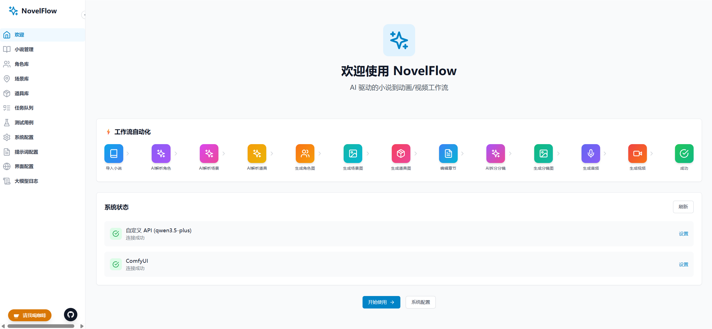
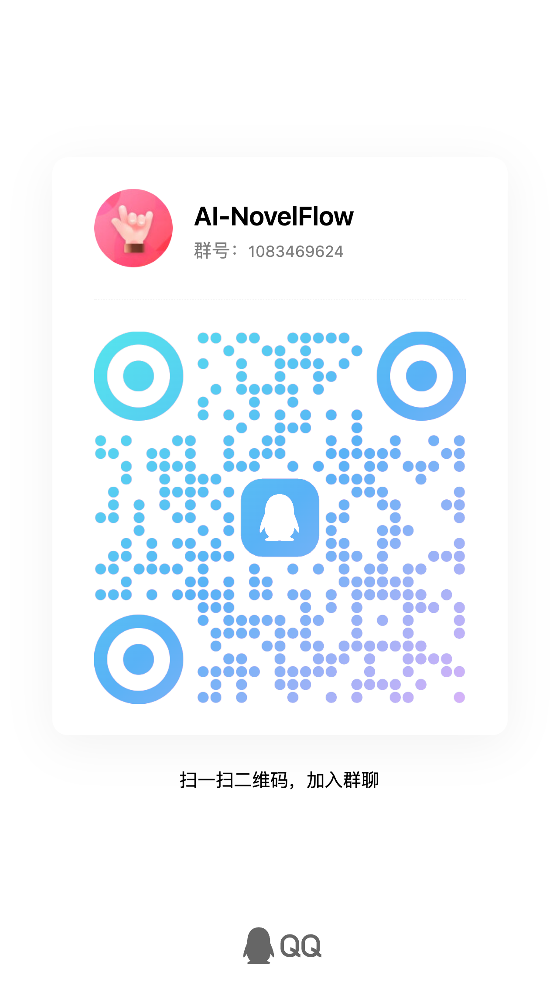

# AI-NovelFlow

**[简体中文](README.md) | [繁體中文](README_TW.md) | [English](README_EN.md) | [日本語](README_JA.md) | [한국어](README_KO.md)**

AI 驅動的小說轉視訊平台

## 專案概述

NovelFlow 把小說文字、角色與場景設定、分鏡圖片、音訊和影片任務串成可編輯的製作流程。可以逐步人工確認，也可以批次處理章回與分鏡。

**製作流程：** 匯入 TXT/EPUB 或範例小說 → AI 解析角色、場景、道具 → 建立參考圖與音色 → 編輯章回並拆分分鏡 → 生成及評審分鏡圖 → Video Director 規劃與執行 Clip → 合併章回/小說影片 → 製作封面並視需要上傳 YouTube。

Video Director 支援多參考圖生影片、影片續生成與時間錨點時序續生成。提示詞、任務、關鍵影格和成果都會保存，方便檢查與重試。

## 界面預覽



## 影片介紹

📺 <a href="https://www.bilibili.com/video/BV1VdZbBDEXF" target="_blank">Bilibili: AI-NovelFlow 小說轉視訊平台介紹</a>

📺 <a href="https://www.youtube.com/watch?v=IlMbeDme2F8" target="_blank">YouTube: AI-NovelFlow 小說轉視訊平台介紹</a>

📺 <a href="https://www.youtube.com/watch?v=DybveicQ9eQ" target="_blank">YouTube: Windows下如何安裝我們的開源項目</a>

## 社群交流

| Telegram 交流群組 | QQ 群 |
|:---:|:---:|
| <a href="https://t.me/AI_NovelFlow" target="_blank">@AI_NovelFlow</a> | 1083469624 |
|  |  |

## 技術棧

- **前端**：React、TypeScript、Tailwind CSS、Vite、Zustand
- **後端**：FastAPI、SQLAlchemy、SQLite、背景任務與檔案儲存
- **AI 與媒體**：可設定的 LLM 服務、ComfyUI、FFmpeg；Moss Image 與 Qwen Image 2.1 圖片預設、MiniMax H3 影片預設、Qwen3-TTS 音訊預設
- **介面**：簡體中文、繁體中文、英文、日文、韓文及可設定時區

## 主要功能

- **小說與章回**：建立、編輯、刪除及匯入 TXT/EPUB；章回解析、批次匯入/拆分、內建範例。
- **素材庫**：按小說或章回解析角色、場景、道具；產生與管理參考圖、角色音色和參考音訊。
- **分鏡與圖片**：AI 拆分、人工編輯、批次生圖、參考圖綁定、關鍵影格、單圖/多圖編輯、AI 圖片品質評審與高清重繪。
- **Video Director**：規劃分鏡與 Clip，支援多參考圖、續生成和時間錨點；保存提示詞、LLM 日誌、任務與成果。
- **Clip 執行檢查**：按時間軸與影格查看生成證據、來源素材及觀察紀錄。
- **音訊與交付**：可選的音色設計與語音生成；合併 Clip、章回和小說影片，預覽首次出鏡姓名牌、製作封面及上傳 YouTube。
- **工作流程與提示詞**：管理 ComfyUI 系統/自訂工作流程、節點映射、匯入/匯出與提示詞範本。
- **任務與通知**：背景佇列、重試與恢復；業務事件、頁面提示音及飛書/Telegram 通知。
- **多語言與時區**：五種介面語言，依使用者時區顯示時間。

## 專案結構

```
AI-NovelFlow/
├── backend/              # FastAPI 後端
│   ├── app/
│   │   ├── api/         # API 路由
│   │   ├── core/        # 核心配置
│   │   ├── models/      # 數據庫模型
│   │   ├── repositories/ # 數據倉庫層
│   │   ├── schemas/     # Pydantic 模型
│   │   ├── services/    # 業務邏輯（LLM、ComfyUI）
│   │   └── utils/       # 工具函數
│   ├── migrations/      # 數據庫遷移腳本
│   ├── prompt_templates/ # 提示詞模板文件
│   ├── workflows/       # ComfyUI 工作流配置
│   ├── user_workflows/  # 用戶自定義工作流
│   ├── user_story/      # 生成的圖片/視訊存儲目錄
│   └── run_server.py
├── frontend/            # React 前端
│   └── my-app/
│       ├── src/
│       │   ├── components/  # 組件
│       │   ├── i18n/        # 國際化翻譯檔案
│       │   ├── pages/       # 頁面
│       │   ├── stores/      # 狀態管理
│       │   └── types/       # TypeScript 類型
│       └── package.json
├── windows_gpu_monitor/ # Windows GPU 監控服務（可選）
│   ├── gpu_monitor.py   # GPU 監控服務
│   ├── requirements.txt # 依賴
│   └── start.bat        # Windows 啟動腳本
├── debug/workflows/     # 調試用工作流樣例，不作為系統預設載入
└── README.md
```

## 快速開始

### 後端啟動

```bash
cd backend
source venv/bin/activate  # Windows: venv\Scripts\activate
uvicorn app.main:app --reload --host 0.0.0.0 --port 8000
```

後端服務將在 http://localhost:8000 運行

### 前端啟動

```bash
cd frontend/my-app
npm install
npm run dev
```

前端服務將在 http://localhost:5173 運行

## API 文件

啟動後端後訪問: http://localhost:8000/docs

## 配置說明

### 1. LLM API 配置

【系統設定】提供 DeepSeek、OpenAI、Gemini、Anthropic、Azure OpenAI、阿里雲百煉、Ollama 與相容 OpenAI API 的自訂服務預設。依所選服務填入 API 位址、模型及金鑰；Ollama 等本地服務可依實際設定使用。也可設定代理，並在【提示詞設定】管理製作階段的範本。

### 2. ComfyUI 配置

- 預設位址：`http://localhost:8188`，可在【系統設定】修改。
- 系統預設 JSON 位於 `backend/workflows/`，註冊規則與節點映射見 `backend/app/constants/workflow.py`；上傳的工作流程位於 `backend/user_workflows/`。介面可匯入、匯出、切換工作流程並設定提示詞、參考圖、時長和輸出節點。
- 圖片預設涵蓋 Moss Image T2I 角色四視圖/場景/道具，以及 Qwen Image 2.1 分鏡、關鍵影格、單圖與多圖編輯。影片預設涵蓋 MiniMax H3 多參考圖、影片續生成、時序續生成、第二遍採樣與 3D latent 放大。音訊工作流程另有 Qwen3-TTS。
- 實際啟用項取決於資料庫設定；`debug/workflows/` 為除錯範例，不會自動註冊為系統預設。

**模型與節點下載**：[夸克網盤](https://pan.quark.cn/s/2a630b7755ed)。只需安裝所選工作流程 JSON 引用的模型與節點。2026-10-23 的盤點涵蓋 Moss Image、Qwen Image 2.1、本地 Qwen PE 重寫模型，以及 H3 主模型/VAE/LoRA/放大模型和外掛。精確路徑、外掛儲存庫與啟用狀態見 [ComfyUI 工作流程依賴清單](docs/COMFYUI_DEPENDENCIES.md)。

### 3. Windows GPU 監控（可選）

如果 ComfyUI 運行在遠程 Windows 服務器上，可以部署 `windows_gpu_monitor` 服務來獲取實時 GPU 狀態。

**功能**：
- 實時監控 GPU 使用率、溫度、顯存佔用
- 監控內存使用情況
- 顯示隊列任務數量

**部署步驟**：

```bash
cd windows_gpu_monitor

# 安裝依賴
pip install -r requirements.txt

# 啟動服務
start.bat
```

服務預設運行在 http://localhost:5000

**訪問測試**：
- 主頁: http://localhost:5000/
- GPU 狀態: http://localhost:5000/gpu-stats

### 4. 提示詞模板配置

可在【提示詞設定】查看系統範本，建立、複製、編輯、匯出自訂範本並綁定小說。範本涵蓋素材解析、分鏡、影片規劃、圖片品質評審等流程；LLM 日誌可追溯實際呼叫。

### 5. 國際化與時區設置

**語言設置**：
- 簡體中文 (zh-CN)
- 繁體中文 (zh-TW)
- English (en-US)
- 日本語 (ja-JP)
- 한국어 (ko-KR)

**時區設置**：
- 支持全球主要時區
- 所有時間顯示（任務列表、LLM日誌等）按指定時區轉換
- 後端統一存儲 UTC 時間，前端根據用戶設置動態轉換

在【系統配置】→【語言與時區】頁面進行設置。

## 已實作的製作功能

- [x] 小說與章回管理、角色/場景/道具解析及素材庫
- [x] 分鏡拆分、批次生圖、圖片評審及高清重繪
- [x] Video Director、多參考圖/續生成/時序續生成與 Clip 檢查
- [x] 音訊生成、章回/小說影片合併、姓名牌預覽與封面
- [x] 工作流程/提示詞管理、任務恢復、事件通知與 YouTube 上傳
- [x] 五語言介面與時區設定

## 使用說明

1. **準備環境**：啟動後端與前端，在【系統設定】填入 LLM 與 ComfyUI 位址；安裝所選工作流程的模型和節點。
2. **匯入小說**：建立小說、匯入 TXT/EPUB 或選用範例；需要時批次匯入或拆分章回。
3. **建立素材庫**：解析角色、場景、道具並生成參考圖；可設計角色音色或上傳參考音訊。
4. **製作分鏡**：編輯章回，AI 拆分並修正分鏡；生成分鏡圖與關鍵影格、查看圖片評審，必要時高清重繪。
5. **生成音影片**：按需生成音訊；在 Video Director 選擇工作流程與參考圖，規劃 Clip 並生成或續生成影片。
6. **檢查與合成**：在任務列表及 Clip 執行檢查器查看狀態、影格與證據；合併 Clip 和章回，按需使用姓名牌預覽。
7. **交付**：合併小說影片、製作及下載封面；連接 YouTube 後可上傳成片。

## 貢獻指南

歡迎為專案做出貢獻！請閱讀 [貢獻指南](docs/CONTRIBUTE_GUIDE.md) 了解如何參與開發。

## License

本專案採用 GNU General Public License v3.0 授權 - 詳見 [LICENSE](LICENSE) 文件。
